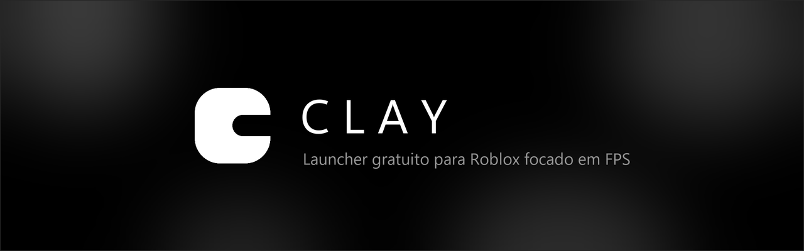

<p align="center">
  
</p>

O CLAY é um launcher pro Roblox no Windows, de graça. Liga o Modo Massinha e o jogo fica liso, tipo massinha de modelar, rodando com bem mais FPS. Ele só mexe nas configurações que o próprio Roblox libera.

**[Baixar o CLAY-win-Setup.exe](https://github.com/envelhece/clay-releases/releases/latest/download/CLAY-win-Setup.exe)** · [site](https://envelhece.github.io/clay-releases/)

<p align="center">
  
</p>

## Quanto de FPS dá pra ganhar

Números do contador do próprio Roblox (Shift+F5), num Ryzen 5 4600G com RTX 5060 e 16 GB, em 1080p:

- Crossroads cheio: 273 FPS no gráfico padrão, 325 a 380 com o Modo Massinha
- Baseplate vazio com o Modo Massinha: até 718 FPS
- Baseplate com o perfil Realista, com sombra e céu azul: 535 FPS

Esse PC trava no processador, então em PC com placa de vídeo fraca a diferença costuma ser maior. No seu pode dar mais ou menos.

<p align="center">
  
  
</p>

## O que ele faz

- **Modo Massinha.** Um botão só. Deixa as texturas lisas (some o granulado do plástico, os pinos e as ondas da água), tira a grama e as nuvens, pinta o céu de cinza e põe a qualidade no mínimo.
- **Configura sozinho.** Na primeira vez ele olha seu PC e ajusta tudo pra mais FPS. Em PC fraco baixa a resolução da tela só enquanto você joga, põe a energia no máximo e desliga a gravação do Xbox. Tudo volta ao normal quando o Roblox fecha.
- **Perfis:** PC Fraco, Equilibrado, Máximo FPS, Massinha e Realista.
- **Painel com Page Up.** Aperta Page Up dentro do jogo, troca o gráfico, a resolução (até 4:3 esticada) e o CLAY reabre o Roblox no mesmo servidor.
- **Importar Fast Flags** por sua conta. O CLAY grava como você colar, e o Roblox ignora as que não estão na lista oficial.
- FPS destravado pelo mesmo limite do menu do jogo, tela cheia exclusiva e as otimizações de tela cheia do Windows desligadas só pro Roblox.
- Fica na bandeja segurando o Roblox em prioridade alta.
- Favoritas, atalho na área de trabalho, tempo jogado de cada experiência, lista de servidores do mais cheio ao mais vazio, região do servidor e status no Discord.
- Mods de cursor, fonte e som (guarda os originais) e limpeza de logs velhos.
- Quando sai versão nova, avisa assim que abre.

<p align="center">
  
  
</p>

## Como instalar

1. Baixe o [`CLAY-win-Setup.exe`](https://github.com/envelhece/clay-releases/releases/latest/download/CLAY-win-Setup.exe) e abra.
2. Se aparecer "O Windows protegeu o computador", clique em **Mais informações** e **Executar assim mesmo**. Isso acontece porque o CLAY é novo e ainda não tem assinatura digital.
3. Pronto. Se faltar o .NET 10 no PC, o instalador baixa sozinho.

Pra tirar, desinstala pelo Windows em Configurações > Aplicativos. O Roblox volta como estava antes.

<details>
<summary>Conferir se o arquivo é o original</summary>
<br>

O SHA-256 do instalador fica nas notas de cada [versão](https://github.com/envelhece/clay-releases/releases/latest) e no site. Abre o PowerShell e roda:

```powershell
Get-FileHash "$env:USERPROFILE\Downloads\CLAY-win-Setup.exe"
```

Se você baixou em outra pasta, troca o caminho. Se o código não bater, apaga o arquivo sem abrir.
</details>

## Dá ban?

O CLAY usa as Fast Flags da [lista que o Roblox liberou](https://devforum.roblox.com/t/allowlist-for-local-client-configuration-via-fast-flags/3966569) e as opções que já existem no menu do jogo. Ele não abre o executável do Roblox, não mexe na memória e não injeta nada. O Roblox já disse que launchers que não modificam o cliente não são afetados pelas medidas contra modificação.

Também não tem nada que dê vantagem. Neblina e paredes continuam lá, o Modo Massinha só deixa o visual mais simples. Não tem multi-instância nem anti-AFK, e o CLAY não guarda o login da sua conta.

Garantia ninguém dá, porque o Roblox pode mudar as regras. Se isso acontecer, o CLAY muda junto.

Baixe só por aqui ou pelo [site](https://envelhece.github.io/clay-releases/). O CLAY nunca pede pra colar comando no PowerShell, então se algum vídeo mandar fazer isso, é vírus.

<br>

<sub>Aqui só ficam os instaladores. O código do CLAY não é público. Feito por fã, sem ligação com a Roblox Corporation.</sub>
